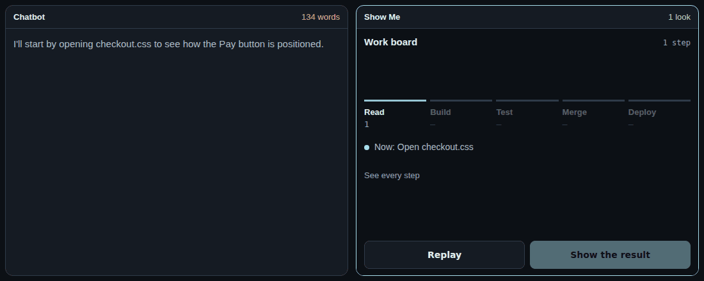
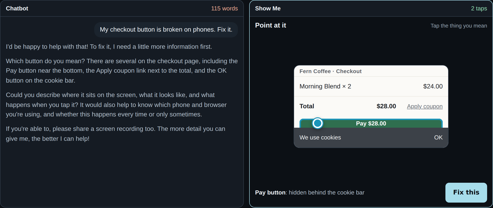
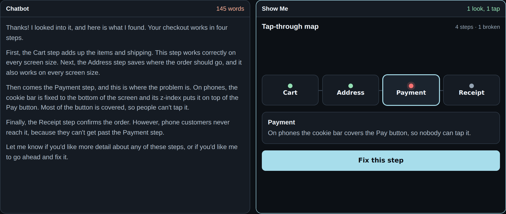
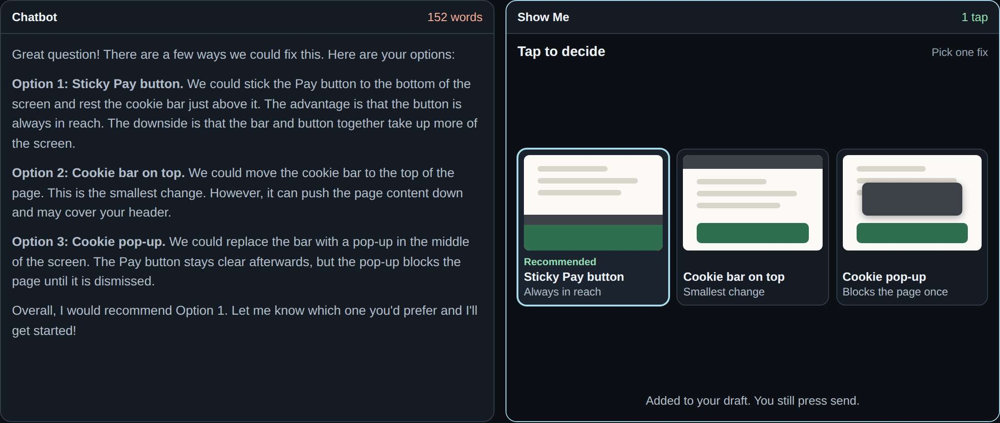
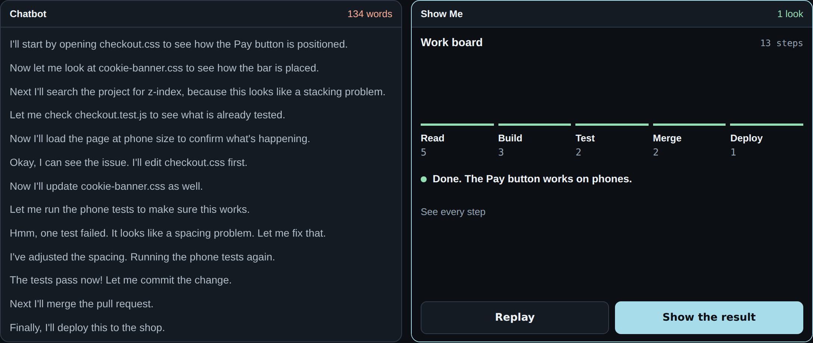
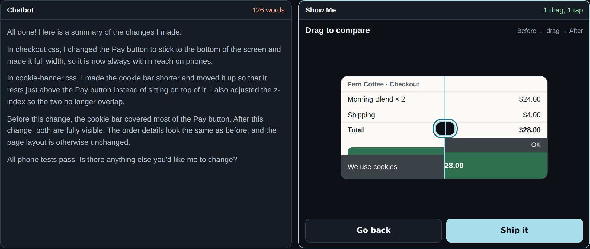
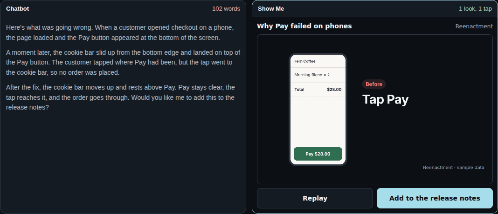

# X Show Me

**Agents should show, not tell.**



**[▶ Try the live examples](https://pisakhov.github.io/x-show-me/)** (2 minutes, no install)

- **The problem:** chatbots answer everything with more text to read.
- **The idea:** when an answer has a shape, the agent builds a small screen you can look at and touch.
- **The scope:** this is about the UI, not the tool. It works with Claude Code, Codex, Pi, Google ADK, LangChain or your own app.

## Before and after

Same task. Same agent. Two ways to talk.

> "My checkout button is broken on phones. Fix it."

### 1. Point at it

You point. The agent doesn't quiz you.



### 2. Tap-through map

The whole system at a glance. The problem is already lit up.



### 3. Tap to decide

See each option. Tap one.



### 4. Work board

Long jobs count real steps. No guessed plan.



### 5. Drag to compare

Don't read about the change. Drag across it.



### 6. Motion clip

If it happens over time, play it.



**The whole job:** 774 words to read, or 6 taps, 1 drag and 3 looks.

*Sample data. Fern Coffee is made up, and both sides were written for this demo.*

## The 5 principles

1. **Shape over sentences.** If the answer has a shape, show the shape.
2. **Next action first.** The one thing to do now is the biggest thing on screen.
3. **One tap, not one paragraph.** A tap fills your draft. You press send.
4. **Real or nothing.** Real renders, real data, real steps. No fake progress.
5. **Details on demand.** Start with the least. Keep the rest one tap away.

One sentence is enough? Then write one sentence. Not everything needs a card.

[Read the principles with examples](PRINCIPLES.md)

## Use it with your agent

Show Me needs a rule, a card and a host.

1. **Give your agent the rule.** Copy [`skills/show-me`](skills/show-me).
2. **It writes a card.** That's one HTML file with no network access.
3. **A host shows it.** A tap comes back as text.

| Agent | The rule goes in | The card shows up through |
|---|---|---|
| Claude Code | `.claude/skills/` | `show-card.mjs` |
| Codex | `.agents/skills/` | `show-card.mjs` |
| Pi | `~/.pi/agent/skills/` | `show-card.mjs` |
| Google ADK | `instruction` | A tool and your web app |
| LangChain | `system_prompt` | A tool and your web app |
| Your own app | Your system prompt | A sandboxed iframe |

[See the setup for each agent](HARNESSES.md)

## Try a card now

This takes about a minute and needs Node 20 or newer.

```bash
git clone https://github.com/pisakhov/x-show-me
cd x-show-me
node skills/show-me/show-card.mjs examples/tap-to-decide.html
```

Tap an option and press Send. Your answer prints in the terminal. That's how an agent hears you.

---

MIT. Part of X Agent. ADHD ideas come from [`i-have-adhd`](https://github.com/ayghri/i-have-adhd). Motion clips render with [HyperFrames](https://github.com/heygen-com/hyperframes) (Apache-2.0).
